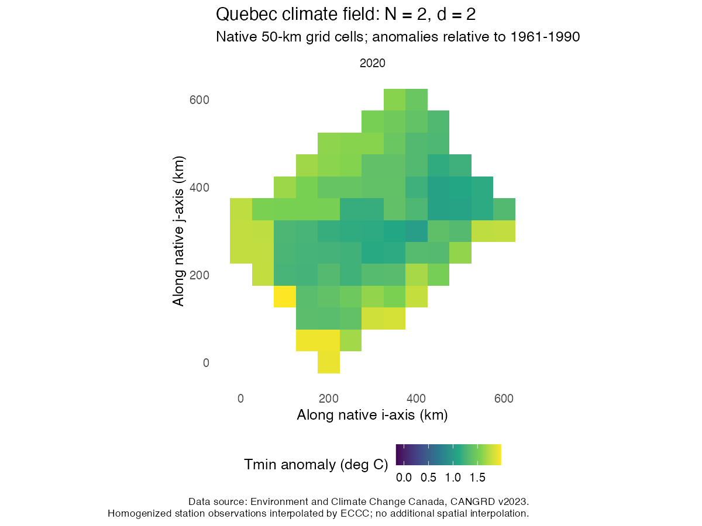
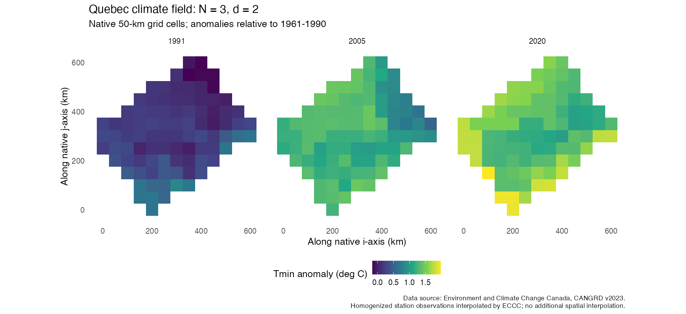
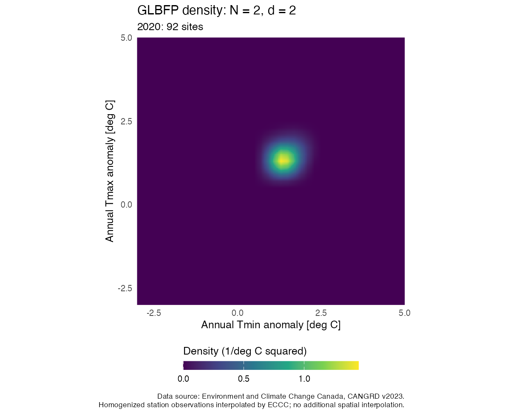
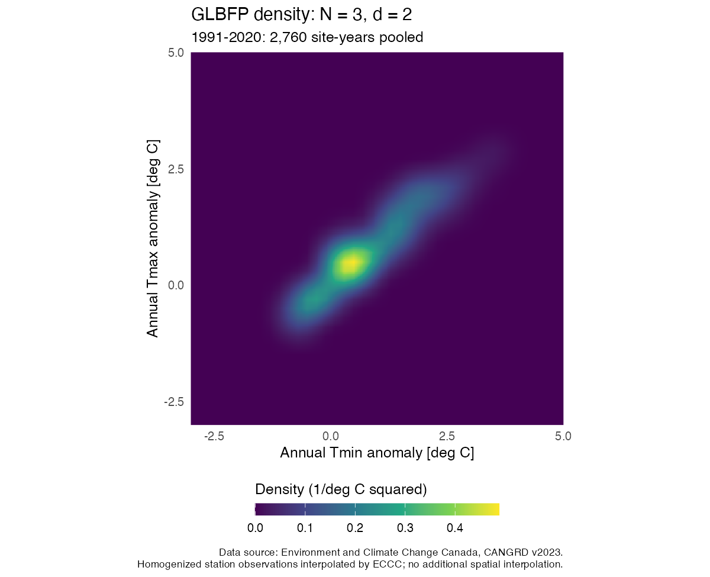

# Validation and performance of GLBFP 0.5.2.9001

This development version corrects grid and boundary behaviour, adds native
evaluation and reusable counts, and represents integer-indexed fields with
`N` index dimensions separately from `d` observation variables. It is intended
for scientific review. It is not a CRAN release or a claim of complete error
freedom.

## Install the version being reviewed

```r
install.packages("remotes")
remotes::install_github("AurelienNicosiaULaval/GLBFP", ref = "develop")
library(GLBFP)
packageVersion("GLBFP")
```

Use the versioned source archive on the GitHub pre-release for a fixed copy
with built vignettes. Source installation needs a C++ compiler. Record the
version and commit in numerical comparisons. `main` and CRAN do not contain
the same set of changes as this review version.

## Definition and conventions

For each observation coordinate, let `b>0`, integer `m>=1`, fine-cell width
`delta=b/m`, and lower-bound anchor `a`. Observation `X_r` is assigned to
`k_r=floor((X_r-a)/delta)` in a half-open cell. Its cell centre is
`c_r=a+(k_r+1/2)*delta`.

Writing `H(u)=max(0,1-abs(u))`, the univariate contribution to the GLBFP is

```text
(1/b) sum_{ell=1-m}^{m-1} (1-abs(ell)/m) H((x-c_r-ell*delta)/delta).
```

Multivariate contributions are products over observation coordinates, averaged
over observations. The one-dimensional basis is nonnegative and integrates
to one. For `m=1` it is the LBFP hat basis. The implementation uses one fine
grid; no equivalence to a separately anchored average of shifted LBFPs is
assumed. ASH uses the corresponding shifted-histogram averaging convention.

The lattice is completed by zero counts outside occupied cells. `max_vals`
controls display limits, not density support. The previous finite-grid
clamping could extrapolate at tight boundaries; this version removes it.
Floating-point boundary assignment follows the documented `floor` rule,
without an additional snapping tolerance.

The R reference tests construct observation-wise bases independently of the
sparse traversal. They check mass, sign, outside-support values, tensor
products, fixed-grid deletions, and equivalence of the computation engines.
The [independent comparison results](independent-agreement.csv) include
dimensions `d=1,2,3,6`, with accepted tolerances specified in the tests.

## Real Quebec examples

The same two temperature-anomaly variables are used in both examples:

| Field | Index coordinates | N | d | Observations |
| --- | --- | ---: | ---: | ---: |
| Quebec, 2020 | Native column and row `(i,j)` | 2 | 2 | 92 |
| Quebec, 1991-2020 | Native column, row and year `(i,j,year)` | 3 | 2 | 2,760 |

These are ECCC CANGRD values, derived from homogenized station observations
and interpolated by ECCC to its native 50-km lattice. The maps below retain
those source-grid cells. Their footprint is the selected window, not a
province outline. No spatial detail is invented by smoothing the map.





The density axes represent temperature anomalies, not spatial coordinates.
The `N=3` density below pools all selected site-years with equal weights.
The common parameters are `b=(0.6,0.6)` degrees C, `m=(3,3)`, fine-cell width
`(0.2,0.2)` degrees C, and anchor `(-8,-8)` degrees C. A fine evaluation grid
improves rendering without changing the counting grid or the estimator.





Density colour scales are shown separately for each density. Their colours
should not be compared without reading the legends. A surface of either
estimate has density as height and still has `d=2`. Actual `d=3` observations
use density slices or isosurfaces.

```r
source(system.file("examples", "quebec_climate.R", package = "GLBFP"))
```

The installed script exports these maps, contours, heatmaps, self-contained
interactive surfaces and their numerical grids. It requires no data download.
Source archive hashes, native indices, variable definitions, extraction
details and ECCC licence attribution are bundled with the CSV. These are
descriptive examples, with no area correction, stationarity assertion,
dependent-field confidence interval or climate-trend test.

## Computation and measured performance

Prepared objects reuse counts for predictions and all fixed-grid `D_i`
scores. Native direct and prefix engines have the same statistical target.
The automatic threshold selects direct enumeration at nominal stencils of
at most 64 cells; it is a heuristic, not a universal optimal choice.

The local campaign uses 14 configurations, three timing repetitions,
equivalent anchors and padded grids, and no timed bandwidth selection.
Preparation, evaluation and all-score costs are separated. Full raw and
median results, including unfavourable cases, are provided:

- [Before/after summaries](benchmarks-before-after.csv)
- [Phase medians](benchmarks-median.csv)
- [Raw timing repetitions](benchmarks-raw.csv)
- [Recorded environment](benchmark-environment.txt)

For example, `n=10,000,d=1,m=2` gives about 268 ms for all scores in the
previous R implementation, versus 2.44 ms with the new automatic engine,
including preparation. The specialized GLBFP-OS engine is faster still in
this case, at about 1.13 ms. Prefix traversal can lose to direct enumeration
for compact grids. These machine- and configuration-specific measurements
do not establish a universal speed ranking. The estimator formulas and native
traversal kernels have not changed since this campaign. The review preparation
adds examples and documentation and refreshes generated Rcpp bindings.
The binding refresh also has a separate three-case timing check, with
[raw repetitions](binding-benchmark-raw.csv),
[phase medians](binding-benchmark-median.csv) and its
[reproduction script](benchmark-bindings.R). Timing differences in either
direction are retained rather than treated as a new speedup claim.

## Bandwidths, uncertainty and article scope

Two transcription errors in the working-note Gaussian-reference L1 bandwidth
heuristic are corrected, including the requested `m`. Corrected widths and
affected boundary values intentionally differ from earlier versions. The
historical helper name `compute_bi_optim()` does not imply established
optimality for density error, testing or outlier ranking.

By default uncertainty fields are `NA`. The opt-in IID method requires
independent observations and fixed bandwidth, anchor and query points. It
uses the sample variance of observation weights divided by `n`. Normal
intervals concern the expected smoothed estimate, not an unbiased true
density. Smoothing bias and data-driven selection remain relevant.

Providing spatial indices does not verify the dependence assumptions of
Carbon and Duchesne's LBFP results. No dependent-field confidence interval
or general GLBFP normality theorem is implemented. Arbitrary `N` concerns
data representation within memory and integer-representability limits;
the computational difficulty also depends strongly on observation dimension
`d` and stencil size.

`compute_Di()` remains the only public score name. It is a local self-support
diagnostic, not an outlier probability or calibrated hypothesis test. The
single-grid LBFP article has a separate frozen `LOOLBFP` replication package.
Its JCGS submission material is not modified by this version. ASH/GLBFP
software extensions and new field representations do not automatically
inherit the article's scientific guarantees.

## Validation evidence

The [validation record](validation.json) identifies the reviewed commit,
local build and check, executed examples, and numerical-core comparison.
The [GitHub checks](https://github.com/AurelienNicosiaULaval/GLBFP/actions/workflows/R-CMD-check.yaml?query=branch%3Adevelop)
provide the current platform results. CI conclusions should be read for the
specific commit being examined. Passing checks do not prove absence of all
numerical or scientific errors.

The pre-release source archive includes built vignettes. The full private
audit directory and the article submission archives are not distributed in
this repository. Licences, source attributions and native-code notices are
retained.
